<h1 align="center">Music Disco</h1>

<p align="center">
  <b>Find your next favourite song from a feeling, or from an artist you already love.</b><br/>
  A Flutter discovery app that hands you short rounds of AI-curated songs you can actually play.
</p>

<p align="center">
  
  
  
  
  
  
</p>

<p align="center">
  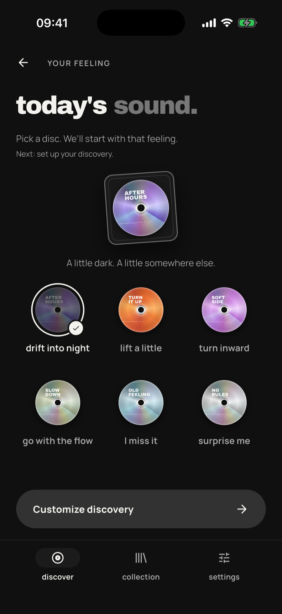
  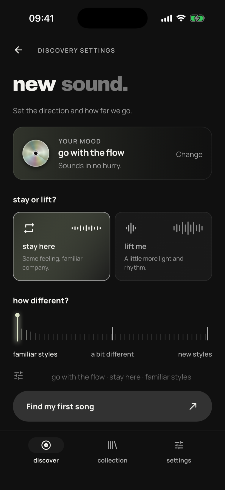
  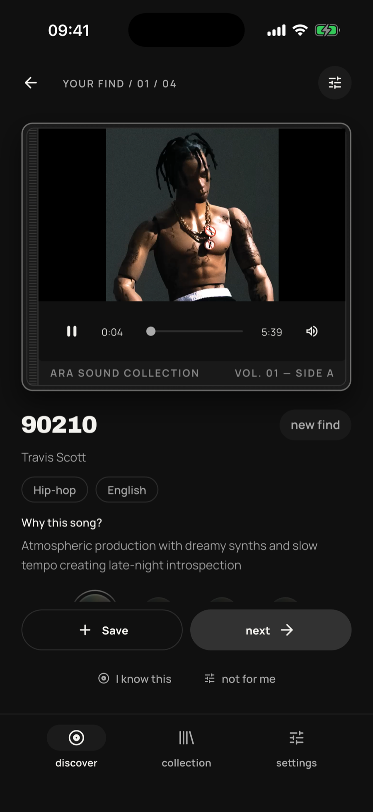
  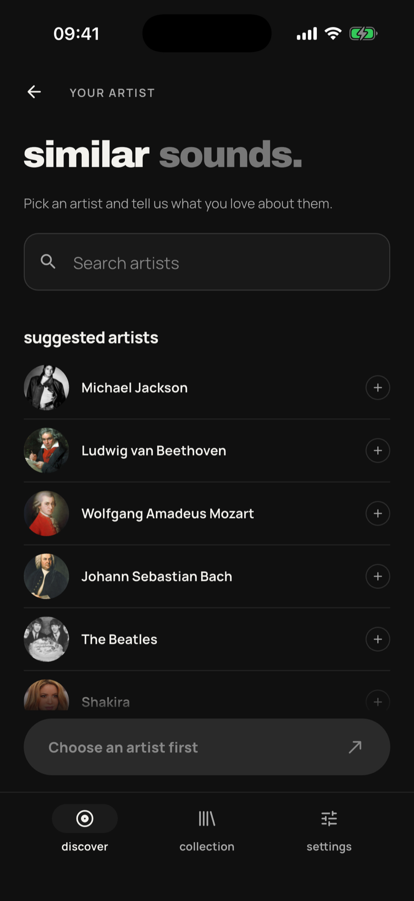
  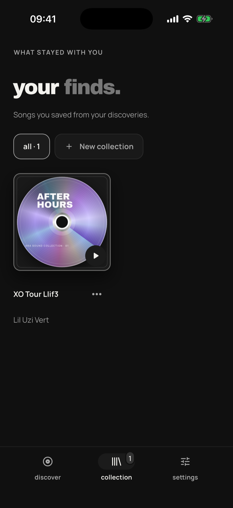
</p>

> [!NOTE]
> This repository is a showcase of the **Flutter client**. It depends on my shared Flutter package `mobile_boilerplate` (expected at `../mobile-boilerplate`) and on a separate backend that is not part of this repository, so it is meant to be read rather than run out of the box. See [Project status](#project-status).

## The idea

Most music apps recommend from your history. Music Disco starts from something simpler: **how you feel right now**, or **one artist you love**. You choose a direction (stay in the mood or lift it) and how far from your comfort zone you want to go. A few seconds later you get a small round of songs, each one verified to be playable, each with a short reason for why it was picked. Not what you want? Say *too calm*, *too lively* or *not my style*, and the song is replaced in place.

## Highlights

| | |
|---|---|
| 💿 **Two ways in** | Pick one of six mood discs, or pick an artist and say what should stand out: atmosphere, vocals, rhythm or overall style |
| 🧭 **Direction and distance** | Stay in the mood or lift it, then slide from familiar styles to new ones |
| 🎯 **Tunable mid-round** | *Too calm*, *too lively*, *not my style* and *I know this* replace the current song without restarting the round |
| ▶️ **Rounds of up to four playable songs** | Every song comes back with a real video, a duration and a short English or Turkish reason |
| 🗂 **Collections** | Save songs on the device and sort them into named shelves |
| 🌍 **Turkish and English** | Full localization with generated keys |
| ♿ **Calmer motion** | A reduce-motion setting, plus lifecycle-aware animations that pause in the background |
| 🖤 **A visual identity** | Holographic discs, a disc-case player, a sound-trace loader and a broken-CD error screen, all drawn in Flutter |

## The experience

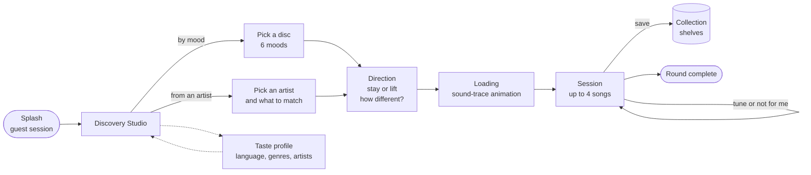

## Screens

Every page below is a real screenshot of the app running against live data.

### 1. Splash
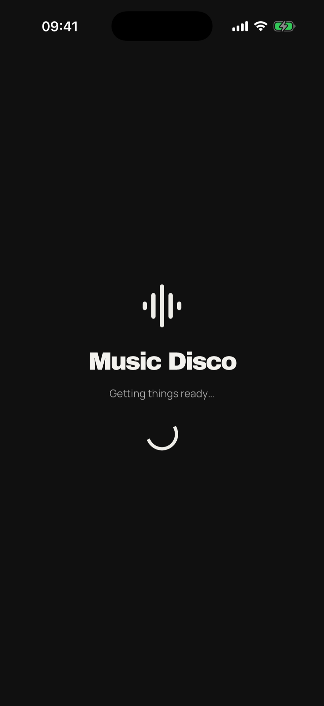

Restores the stored guest session or creates one. There is no sign-up wall: a new user goes straight from this screen into discovery. If the network fails, the stored guest is kept so a retry can restore it instead of creating a second anonymous user.

<br clear="right"/>

### 2. Discovery Studio
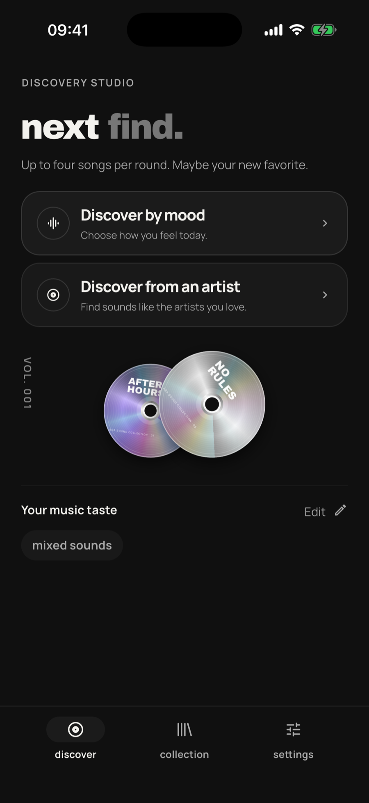

The home screen. Two entry cards (*Discover by mood* and *Discover from an artist*), a shortcut back to your last find, and a summary of your taste profile. It exists to put the two ways of starting a round in front of everything else.

<br clear="right"/>

### 3. Mood


Six holographic discs: *drift into night*, *lift a little*, *turn inward*, *go with the flow*, *I miss it* and *surprise me*. People often know a feeling before they know a genre, so the round starts from the feeling.

<br clear="right"/>

### 4. Direction


Two decisions: *stay here* or *lift me*, and how far to travel (*familiar styles*, *a bit different*, *new styles*). The same screen serves both the mood and the artist flow.

<br clear="right"/>

### 5. Loading
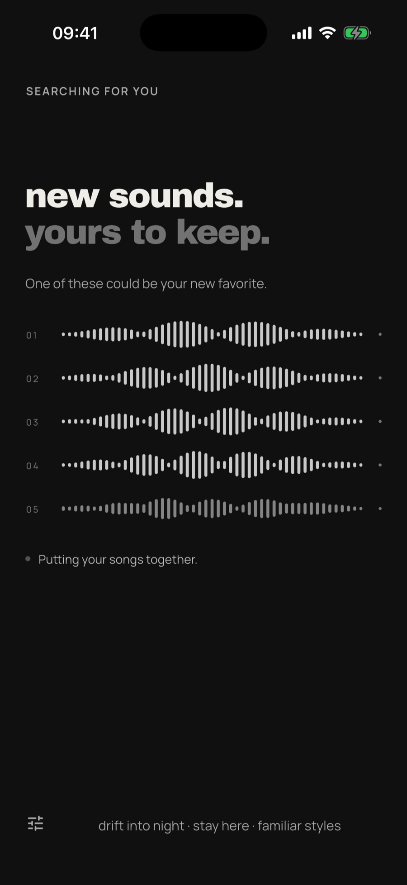

A monochrome sound-trace animation with rotating status lines while the round is assembled. It respects the reduce-motion setting and pauses when the app leaves the foreground.

<br clear="right"/>

### 6. Session


The core screen: a disc-case player for the current song, a *Why this song?* explanation, save with a shelf picker, and quick reactions. A tune sheet lets you change what comes next without losing the song you are on.

<br clear="right"/>

### 7. Artist reference


Search for an artist, then choose what should stand out: atmosphere, vocals, rhythm or overall style. Your saved artists and a few suggestions sit above the search results.

<br clear="right"/>

### 8. Taste
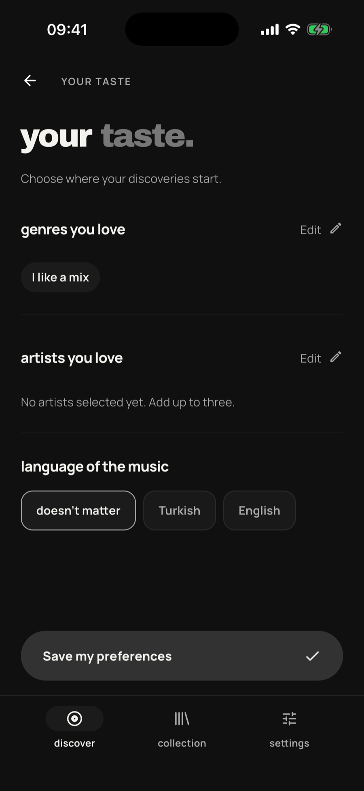

Your standing preferences: the language of the music, up to three genres and up to three artists. They steer mood rounds; in artist rounds the chosen artist leads and the rest stays out of the way.

<br clear="right"/>

### 9. Taste: genres
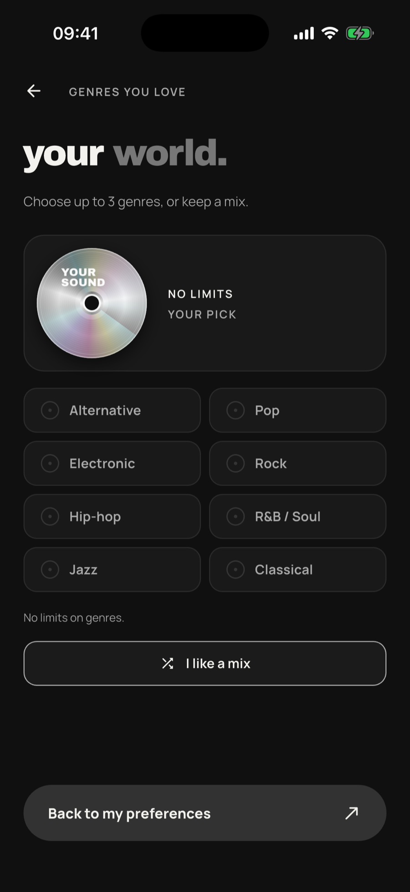

Pick up to three genres, or keep a mix. A live disc previews your selection.

<br clear="right"/>

### 10. Taste: artists
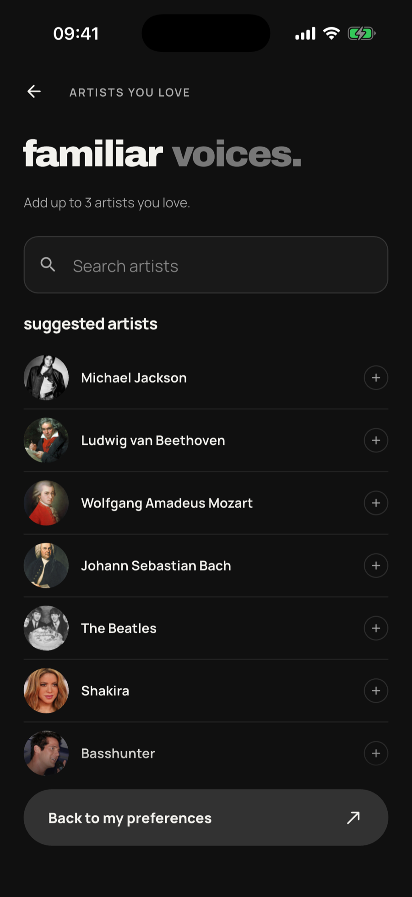

Add up to three artists you love, with search and clear add and remove feedback.

<br clear="right"/>

### 11. Collection


Songs you saved, stored on the device. Create, rename and delete shelves, move songs between them, and play any saved song.

<br clear="right"/>

### 12. Settings
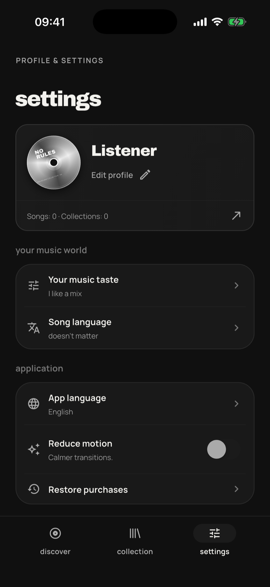

Profile name, music taste, song language, app language (Turkish or English), the reduce-motion switch, and an about and legal section.

<br clear="right"/>

## How it works

### A round, end to end

The Flutter client never talks to the language model or to YouTube directly. It sends the user's choices to a server-side recommendation service and then **validates everything that comes back**.

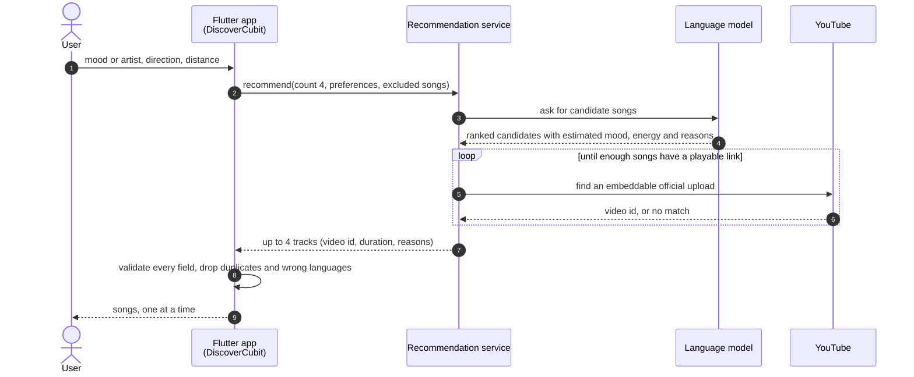

### Reacting to a song

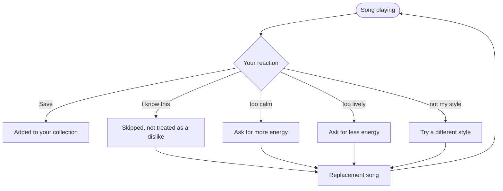

### Round lifecycle

`DiscoverCubit` models a round as a small state machine. Empty results and provider errors are different failures and get different screens.

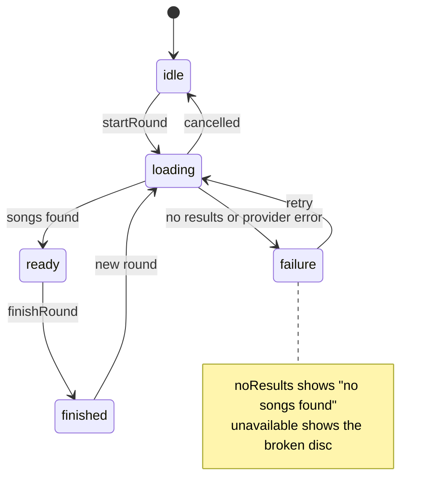

## Architecture

The app is feature-first. Each feature owns its `bloc`, `data`, `domain` and `presentation` folders, and the domain layer never imports data or UI code.

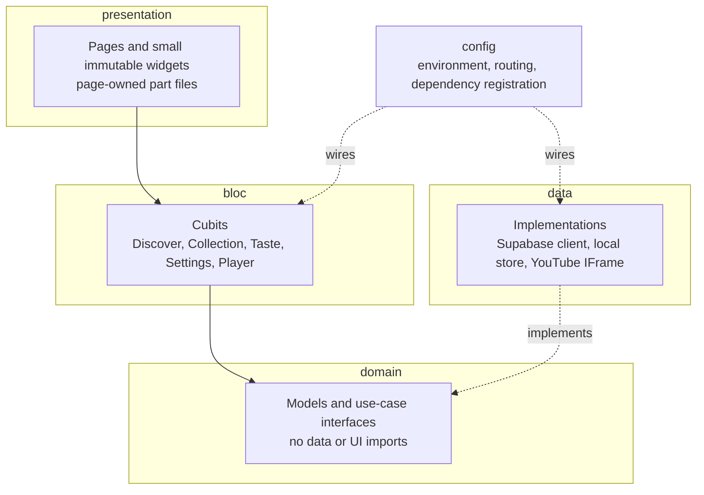

```text
lib/
  config/            app composition, environment, routing, dependency registration
  core/
    design_system/   design tokens and styles: Sp, Stroke, Opacities, FontSize,
                     LineHeight, LetterSpacing, Motion*, colors, text styles
    localization/    generated locale keys, supported languages
    backend/         Supabase failure mapping and table/function names
    util/            small helpers (playback time label, widget tree rebuild)
    widgets/         shared UI: DiscCover, BrokenDisc, DiscCase, AppCtaButton, ...
  features/
    auth/            anonymous guest session
    discover/        moods, direction, artist reference, rounds, session
    taste/           language, genres, artists
    collection/      saved songs and shelves
    player/          YouTube IFrame player behind a small wrapper
    settings/        profile, language, motion
    core/home/       tab shell and bottom navigation
```

## Engineering notes

- **Stale-response guard.** `DiscoverCubit` tags each request and ignores any response that is no longer current, so a slow reply can never overwrite a newer round. Every request also has a timeout.
- **Typed failures.** *No songs match* and *recommendations are unavailable* are distinct states (`DiscoverFailure`) and render different screens, instead of one generic error.
- **Never trust the wire.** `SupabaseDiscoveryRepository` validates every field of every track (video id format, duration range, energy range, reason lengths, language) and rejects the response if anything is off.
- **Bounded concurrency in the UI.** Actions are blocked while a replacement is in flight, so reactions cannot race each other.
- **Guest session safety.** An existing guest session is restored before a new one is created, and network errors never trigger a new anonymous sign-up.
- **Accessible motion.** The loader and transitions read the OS reduce-motion flag and an in-app switch, and animations stop when the app is backgrounded.
- **Custom painting.** `DiscCover` and `BrokenDisc` are drawn with `CustomPainter`: sweep gradients, groove rings, a chipped rim and jagged cracks, with no image assets.
- **Tested where it matters.** Cubits, the repository (with a mock HTTP client), and the painter.

## Tech stack

| Area | Choice |
|---|---|
| UI | Flutter, Dart 3, custom painters, `flutter_screenutil` |
| State | Cubit (`flutter_bloc`) with `Equatable` states |
| Navigation | `go_router` with a stateful shell for the three tabs |
| Localization | `easy_localization`, English and Turkish, generated `LocaleKeys` |
| Backend client | `supabase` (Dart) for the guest session and the recommendation call |
| Playback | `youtube_player_iframe` behind a wrapper class |
| Storage | `flutter_secure_storage` for the session, local store for collections |
| Shared code | `mobile_boilerplate`, my own package for DI, auth contracts and base widgets |

## Code tour

If you only have a few minutes, start here:

| File | Why it is interesting |
|---|---|
| `lib/features/discover/bloc/discover_cubit.dart` | Round state machine, stale-response guard, replacement flow |
| `lib/features/discover/data/supabase_discovery_repository.dart` | Request building and strict response validation |
| `lib/core/widgets/disc_cover.dart` | The holographic disc cover painter |
| `lib/core/widgets/broken_disc.dart` | The broken-CD error illustration |
| `lib/features/discover/presentation/widgets/discovery_loading_view.dart` | Lifecycle-aware, reduce-motion-aware loader |
| `lib/config/app_router.dart` | Stateful shell routing and the auth redirect |
| `test/` | Cubit, repository, proxy and painter tests |

## Project status

This is a portfolio showcase of the client app.

- It depends on `mobile_boilerplate`, expected as a sibling checkout at `../mobile-boilerplate`.
- It talks to a separate backend (a guest-auth project and a recommendation service) that is not published here, so a fresh clone will not return songs.
- Playback uses the official YouTube IFrame player, in the foreground only.

## Running it (for reference)

```sh
flutter pub get
cp .env.example.json .env.local.json
# Fill in the project URL and publishable key of your own backend.
flutter run --dart-define-from-file=.env.local.json
```

Configuration is read from Dart defines and `.env.local.json` is ignored by Git. Never put a service-role key or any secret into the app config.

```sh
dart format lib test
flutter analyze
flutter test
```

Regenerate localization keys after editing both `assets/translations/en.json` and `tr.json`:

```sh
dart run easy_localization:generate -S assets/translations -s en.json -f keys -o locale_keys.dart -O lib/core/localization
```
